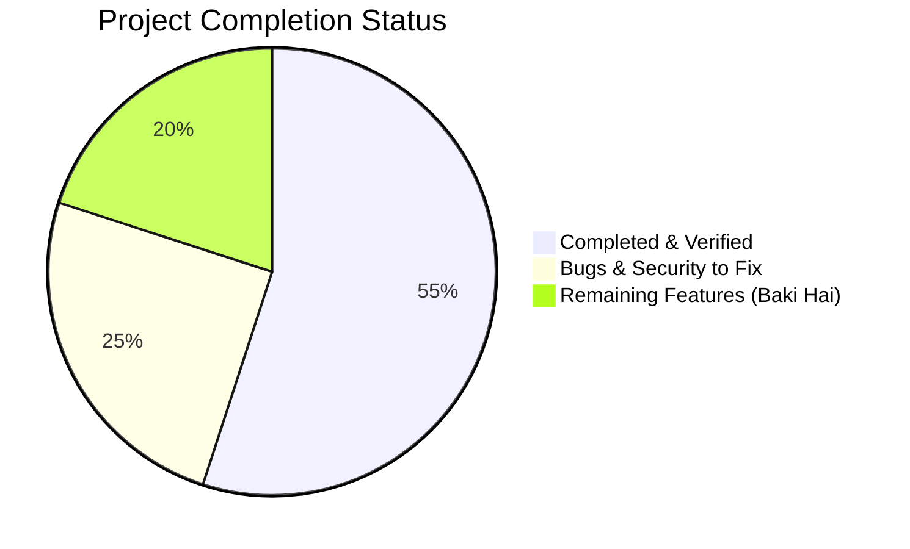

# 📌 Project Status — ESP32 Home Control (ApnaGhar)

This document tracks current project progress, where development paused, what features are completed, and what critical items remain pending ("Baki Hai").

---

## 📊 Overall Progress Dashboard

- **Current Status**: **~55% Done**, **~45% Remaining / Hardening Needed**
- **Last Active Commit**: `7cb4678` — *feat: Add ApnaGhar Flutter mobile app* (March 12, 2026)
- **Primary Architect / Lead**: Mohammad Sakib Ahmad (`@MohammadSakibAhmad0874`)
- **Firmware Base**: ESP32 Arduino Core (Dual-Core Xtensa LX6)
- **Active Deployments**:
  - Cloud Backend: Railway (`esp32-home-control-using-firebase-system-production.up.railway.app`)
  - Web Frontend: Vercel (`web-iota-ruddy-37.vercel.app`)

---

## ⚖️ Status Matrix: DONE ✅ vs BAKI HAI ⏳

| DONE (Kaam Ho Chuka Hai) ✅ | BAKI HAI (Abhi Karna Baki Hai) ⏳ |
|:---|:---|
| **4-Channel Relay Control** via GPIO (23, 22, 21, 19) | **Firebase SDK Modernization** (Migrate to `Firebase_ESP_Client` event streaming) |
| **NVS State Persistence** using `Preferences.h` | **Firebase Security Rules** (`database.rules.json` with user auth scoping) |
| **Captive Portal WiFi Setup** (`SmartHome_Setup` AP) | **Firebase Token Auto-Refresh** (1-hour expiry bug resolution) |
| **Always-On Dual-Mode Hotspot** (`SmartHome_Control` AP) | **Hardware Current Sensing** (PZEM-004T or ACS712 for real kWh) |
| **mDNS Device Discovery** (`http://smarthome.local`) | **Over-the-Air (OTA) Updates** (`ArduinoOTA` / `ElegantOTA`) |
| **Local Web Interface** on Port 80 for LAN switching | **Hardware Watchdog Timer (WDT)** for automatic hang recovery |
| **FastAPI Backend (Railway)** with JWT Auth & Postgres | **Custom PCB Design & Gerbers** (Replacing loose jumper wires) |
| **Web Dashboard (Vercel)** with dark glassmorphism UI | **3D Enclosure / DIN-rail case** for wall switchboard safety |
| **Device Claiming Flow** (User links unique `DEVICE_ID`) | **Voice Assistant Skills** (Live Alexa Skill & Google Assistant action) |
| **Smart Scheduler Engine** (Day-of-week time triggers) | **Flutter Mobile App Production Build** (APK/AAB signing, Play Store) |
| **Estimated Power Tracking** (Algorithm in backend) | **Mobile Push Notifications** via Firebase Cloud Messaging (FCM) |
| **Admin Device Oversight Panel** | **Physical Wall Switch / Sensor Feedback** loop detection |
| **Comprehensive Engineering Documentation** | **Physical Snubber / Flyback Diode Circuit** for inductive load spikes |

---

## 🔍 Where We Stopped (Chronological Audit)

### 1. Last Git Activities
1. **Commit `7cb4678` (March 12, 2026)**: Added initial Flutter mobile app codebase (`apnaghar_app/`) with Provider state management, JWT auth, WebSocket client, and dashboard screens.
2. **Commit `b553488`**: Fixed 4 frontend UI bugs: admin toggle sync, clean URL routing on Vercel, UTC timezone alignment in schedule executor, and dashboard WebSocket broadcast listener.
3. **Commit `5be4741`**: Updated production Vercel frontend URL configuration.
4. **Commit `8175941`**: Added default admin seeding to database startup on Railway.

### 2. Current State of Modules
- **Firmware**: Operates locally with high stability on captive portal and local web server. WebSocket server sync is functional with Railway backend. Firebase REST polling (`firebaseSync.h`) is functional as prototype but unoptimized for long-term production.
- **Backend**: FastAPI app runs on Railway with asyncpg and PostgreSQL. Core endpoints for `/api/auth`, `/api/devices`, `/api/schedules`, and WebSocket `/ws/esp/{device_id}` are operating.
- **Web Dashboard**: Responsive dark-mode dashboard live on Vercel. Controls relays, sets timers/schedules, displays power calculations.
- **Mobile App**: Dart/Flutter project created with screens and models, but not yet packaged into release APK or published.
- **Hardware Integration**: Operating on loose jumper wires, breadboards, and off-the-shelf relay modules. Requires high-voltage isolation PCB before residential wall installation.

---

## 🎯 Next Immediate Action Items

1. **Security Lockdown**:
   - Rotate exposed Firebase Web API key and database secrets.
   - Deploy production Firebase Realtime Database security rules.
   - Remove hardcoded credentials from repository history and enforce environment variables.
2. **Firmware Hardening**:
   - Enable ESP32 Task Watchdog Timer (`esp_task_wdt`).
   - Add Over-The-Air (OTA) firmware upgrade mechanism.
   - Implement non-blocking asynchronous WiFi reconnect logic.
3. **Mobile App Polish**:
   - Complete Flutter app asset bundles (icons/splash screen).
   - Test APK build on physical Android and iOS devices.
4. **Hardware Safety**:
   - Design custom PCB with 5V 2A regulator, optocoupler isolation, varistors (MOV) for spike protection, and screw terminal blocks.
