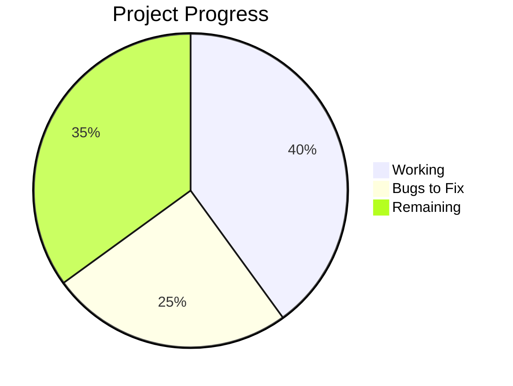
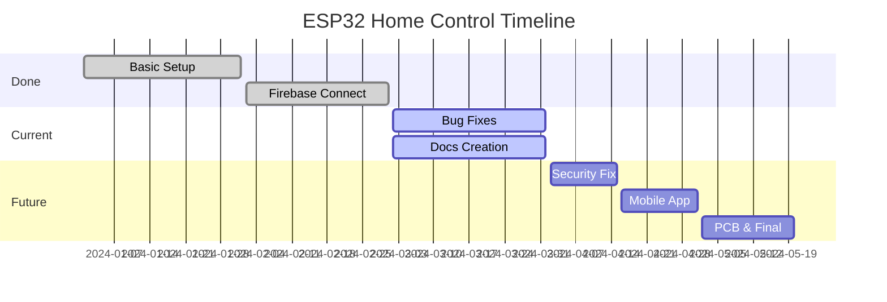
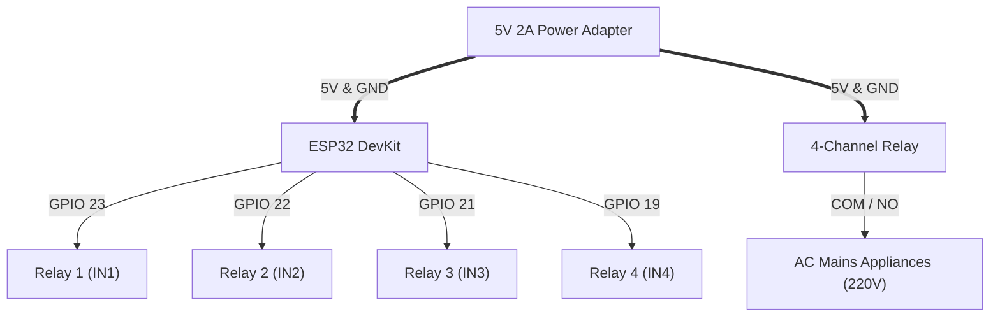

# 🏠 ESP32 Home Control Using Firebase (ApnaGhar)

> **Apna Ghar, Apna Control — Smart Home, Your Way**

An open-source, production-ready IoT smart home automation platform powered by the **ESP32 microcontroller** and **Firebase Realtime Database / Cloud Backend**. Control up to 4 high-voltage home appliances (lights, fans, sockets) from **anywhere in the world** via mobile app or web browser, directly over your local WiFi network, or completely offline via an always-on direct hotspot.

---

## 🏷️ Badges


---

## 📊 Project Status Dashboard





- **Detailed Status**: Check [PROJECT_STATUS.md](PROJECT_STATUS.md) and [docs/PROJECT_STATUS.md](docs/PROJECT_STATUS.md).
- **Bug Audit**: Check [BUG_REPORT.md](BUG_REPORT.md) (17 issues catalogued with fixes).

---

## ✨ Features

- 📱 **Captive Portal WiFi Wizard** — Connect and configure home WiFi right from your phone browser without touching C++ code.
- 📡 **Always-On Hotspot (Dual Mode)** — ESP32 simultaneously broadcasts `SmartHome_Control` (`192.168.4.1`) for direct offline access.
- ☁️ **Global Cloud Control** — Control appliances from anywhere in the world using Firebase Realtime Database or WebSocket cloud relay.
- ⚡ **Real-Time State Sync** — Instant physical relay switching with bi-directional client synchronization.
- 💾 **Power-Loss State Memory** — NVS flash storage automatically remembers every switch position after a power outage.
- 🔐 **Secure Device Claiming** — Unique `DEVICE_ID` binding links physical hardware to authenticated user accounts.
- 👑 **Admin Oversight Panel** — Centralized administration dashboard to monitor telemetry, IP addresses, and operational states across all devices.
- ⏰ **Smart Automation Schedules** — Time-based ON/OFF rules with day-of-week selection (e.g. Mon–Fri office lighting).
- 📊 **Energy & Cost Estimation** — Track daily running hours, kilowatt-hours (kWh), and estimated electricity cost (₹).
- 🌐 **Zero-Config mDNS** — Access local hardware seamlessly at `http://smarthome.local`.

---

## 🛠 Hardware Required

| Component | Specification | Quantity | Notes |
|:---|:---|:---:|:---|
| **ESP32 DevKit V1** | Dual-Core Xtensa LX6, 2.4GHz WiFi | 1 | Microcontroller running firmware |
| **4-Channel Relay Module** | 5V DC Coil, 10A 250V AC Contacts | 1 | Active-LOW optocoupler isolated |
| **External DC Power Supply**| 5V 2.0A Regulated DC Adapter | 1 | Prevents ESP32 brownouts |
| **DuPont Jumper Wires** | Female-to-Female / Male-to-Female | 15 | Logic connections |
| **Breadboard / Perfboard** | Half-size solderless breadboard | 1 | Prototyping and testing |
| **AC Load & Holder** | 220V Bulb / Test Socket | 1–4 | Testing load switching |

---

## 🔌 Quick Pin Mapping

| ESP32 GPIO | Connected To | Logic Type | Safety Level |
|:---:|:---:|:---:|:---:|
| **GPIO 23** | Relay Channel 1 (IN 1) | Active-LOW | ✅ 100% Safe |
| **GPIO 22** | Relay Channel 2 (IN 2) | Active-LOW | ✅ 100% Safe (I2C SCL) |
| **GPIO 21** | Relay Channel 3 (IN 3) | Active-LOW | ✅ 100% Safe (I2C SDA) |
| **GPIO 19** | Relay Channel 4 (IN 4) | Active-LOW | ✅ 100% Safe |
| **GND** | Relay GND & Power Supply GND | Ground | ✅ **Mandatory Common Ground** |

---

## 📐 Wiring Diagram



```
+-------------------------------------------------------------+
|                                                             |
|           [ PLACEHOLDER: ACTUAL HARDWARE WIRING PHOTO ]     |
|                                                             |
|   Insert photograph here showing ESP32, 4-channel relay,   |
|   power supply, and electrical safety enclosure wiring.     |
|                                                             |
+-------------------------------------------------------------+
```

---

## 🚀 Quick Setup Steps

1. **Assemble Hardware**: Wire the ESP32 to the 4-channel relay module following the [Hardware Guide](docs/HARDWARE.md).
2. **Flash Firmware**: Open `firmware/HomeControlSketch.ino` in Arduino IDE and upload to your ESP32.
3. **Configure WiFi**: On your smartphone, connect to WiFi **`SmartHome_Setup`** (Password: `12345678`) and select your home network in the portal.
4. **Claim Online**: Visit the [Web Dashboard](https://web-iota-ruddy-37.vercel.app), create an account, enter your `DEVICE_ID`, and start controlling your appliances!

👉 **Read the complete step-by-step setup walkthrough in [docs/SETUP.md](docs/SETUP.md)**.

---

## 📱 Screenshots & Application Previews

```
+-------------------------------------------------------------+
|                                                             |
|           [ PLACEHOLDER: MOBILE APP & WEB DASHBOARD ]       |
|                                                             |
|   - Web Dashboard: Light/Fan toggles, energy metrics        |
|   - Flutter Mobile App: Splash screen, dark glassmorphism   |
|   - Captive Portal: Smartphone WiFi configuration wizard    |
|                                                             |
+-------------------------------------------------------------+
```

---

## 🐛 Summary of Bugs Found (Audit Overview)

Our comprehensive architectural audit identified **17 issues** across security, firmware stability, and power:

| Severity | Count | Primary Impact | Recommended Action |
|:---:|:---:|:---|:---|
| **CRITICAL** | 4 | Exposed API keys, open database rules, brownout risk | Rotate keys, deploy rules, isolate relay power |
| **HIGH** | 5 | 2s HTTP polling lag, token expiry disconnect, no watchdog | Migrate to streaming, add token refresh, enable WDT |
| **MEDIUM** | 5 | I2C pin conflicts, missing OTA update, software energy estimate | Remap pins, add ElegantOTA, add PZEM-004T sensor |
| **LOW** | 3 | Default passwords, redundant sketch duplicates | Derive passwords from MAC, unify sketch directory |

👉 **Read the full vulnerability report and code fixes in [BUG_REPORT.md](BUG_REPORT.md)**.

---

## 📚 Complete Documentation Index

All technical documents are located in the [`docs/`](docs/) directory:

1. [docs/PRD.md](docs/PRD.md) — Product Requirement Document (Vision, Personas, User Stories)
2. [docs/HARDWARE.md](docs/HARDWARE.md) — Complete BOM, Pin Mapping Table, JD-VCC Isolation & Safety
3. [docs/FIRMWARE.md](docs/FIRMWARE.md) — Arduino C++ Lifecycle, State Machine, Module Breakdown
4. [docs/ARCHITECTURE.md](docs/ARCHITECTURE.md) — Full System Architecture & Sequence Diagrams
5. [docs/DATABASE.md](docs/DATABASE.md) — Firebase RTDB Schema & Production Security Rules
6. [docs/SECURITY.md](docs/SECURITY.md) — Comprehensive Security Audit & Remediation Guide
7. [docs/SETUP.md](docs/SETUP.md) — Step-by-Step Installation & Running Guide
8. [docs/BUG_REPORT.md](docs/BUG_REPORT.md) — Detailed 17-Point Bug Audit & Matrix
9. [docs/PROJECT_STATUS.md](docs/PROJECT_STATUS.md) — Done vs Baki Hai Comparison & Metrics
10. [docs/ROADMAP.md](docs/ROADMAP.md) — 4-Phase Production Milestone Plan & Gantt Timeline

---

## ⚠️ High-Voltage Electrical Warning

> [!CAUTION]
> This system interacts directly with 110V–240V AC mains electricity, which carries a severe risk of electric shock, personal injury, or electrical fires. Always turn off the main circuit breaker before touching any high-voltage wiring. Never handle open relay contacts while powered.

---

## 📝 License

Distributed under the MIT License. Built with ❤️ for open, accessible smart home automation by **Mohammad Sakib Ahmad**.
