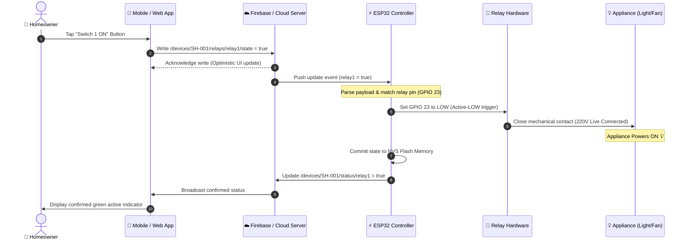

# 🏛️ Full System Architecture — ESP32 Home Control

This document presents the complete end-to-end architecture of the ESP32 Home Control System across hardware, edge firmware, cloud infrastructure, and client applications.

---

## 1. System Topology Overview

The architecture supports a hybrid dual-channel communication model:
1. **Cloud Channel**: Connects clients and microcontrollers over the global internet via Firebase Realtime Database or WebSocket cloud relay.
2. **Local Edge Channel**: Connects clients directly over LAN/mDNS or offline SoftAP without leaving the home network.

---

## 2. Diagram 1: Connection & Network Flow

```mermaid
graph LR
    subgraph CLIENTS [User Interfaces]
        MobileApp["📱 Flutter Mobile App"]
        WebDashboard["💻 Web Dashboard (Vercel)"]
        LocalBrowser["🌐 Local Browser (LAN / AP)"]
    end

    subgraph CLOUD_INFRA [Cloud Platform]
        Firebase_RTDB[("🔥 Firebase Realtime DB / Cloud Backend")]
    end

    subgraph EDGE_HARDWARE [Edge Hardware (Home Switchboard)]
        ESP32["⚡ ESP32 Microcontroller"]
        Relays["🔌 4-Channel Relay Module"]
        Home_Appliances["💡 Home Appliances (Lights, Fan, AC Load)"]
    end

    MobileApp -->|HTTPS / WSS| Firebase_RTDB
    WebDashboard -->|HTTPS / WSS| Firebase_RTDB
    LocalBrowser -->|HTTP 192.168.4.1| ESP32

    Firebase_RTDB -->|WebSocket / REST Stream| ESP32
    ESP32 -->|GPIO 23, 22, 21, 19| Relays
    Relays -->|220V AC Phase Switching| Home_Appliances
```

---

## 3. Diagram 2: Two-Way Data Synchronization Sequence

This sequence diagram illustrates the lifecycle of a remote command initiated by the user, executed by the physical hardware, and confirmed back to the interface.



---

## 4. Diagram 3: Current Architecture vs. Future Production Target

```mermaid
graph TB
    subgraph CURRENT_ARCH [Current Architecture: Hybrid Prototyping]
        C_User[Clients: Web + Draft Flutter]
        C_Web[Vercel Static Frontend]
        C_Back[Railway Python FastAPI Backend]
        C_FB[Firebase RTDB REST Prototype]
        C_ESP[ESP32: Polling HTTP & WS Client]
        C_Relay[Loose 4-Relay Board + Jumper Wires]
        C_Power[Calculated Software Wattage Estimate]

        C_User --> C_Web & C_Back & C_FB
        C_Back & C_FB <--> C_ESP
        C_ESP --> C_Relay
        C_ESP -.-> C_Power
    end

    subgraph FUTURE_ARCH [Future Architecture: Production v2.0]
        F_User[Clients: Flutter App + Web + Voice]
        F_Voice[Amazon Alexa & Google Home]
        F_Auth[Firebase Auth with JWT Auto-Refresh]
        F_Cloud[Unified Event Engine: MQTT / WSS]
        F_OTA[Secure OTA Firmware Management]
        F_ESP[ESP32 with Hardware WDT & FreeRTOS Tasks]
        F_Sensor[PZEM-004T / CT Hardware Current Sensor]
        F_PCB[Custom Dual-Layer Optical PCB + MOV]

        F_User --> F_Auth
        F_Voice --> F_Cloud
        F_Auth --> F_Cloud
        F_Cloud <== Secure Encrypted MQTT ==> F_ESP
        F_OTA -. Push Binaries .-> F_ESP
        F_ESP --> F_PCB
        F_ESP <--> F_Sensor
    end
```



---

## 5. Architectural Comparison Matrix

| Component | Current Implementation | Future Production Target (v2.0) |
|:---|:---|:---|
| **Cloud Communication Protocol** | HTTP REST Polling (Firebase) + WebSockets (Railway) | Low-overhead persistent MQTT / WSS with TLS 1.3 |
| **Authentication Flow** | Legacy DB Secrets / Hardcoded API Keys | Firebase Authentication (OAuth2 / Identity Toolkit) + Auto-Refresh |
| **Firmware Architecture** | Single-threaded Arduino `loop()` | Dual-Core FreeRTOS tasks (Core 0: Network; Core 1: GPIO & Sensors) |
| **Power & Energy Metering** | Theoretical software estimation ($P \times t$) | Real-time voltage, current, active power via PZEM-004T UART IC |
| **Voice Automation** | Documented concepts only | Certified Alexa Smart Home Skill & Google Actions fulfillment |
| **Fail-Safe Mechanism** | Basic software reconnect loop | Hardware Task Watchdog (WDT) + Brownout reset circuitry |
| **Hardware Enclosure** | Open breadboard / loose modules | Custom enclosure with terminal isolation and DIN-rail mount |
