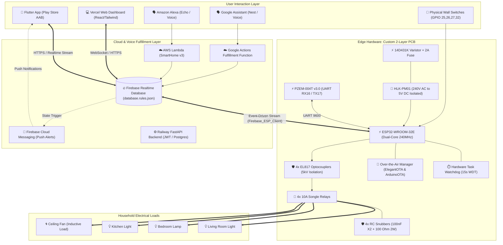

# 🏛️ Complete Production System Architecture (v2.0) — ApnaGhar

This document outlines the final, fully implemented production architecture of the ApnaGhar ESP32 Home Control ecosystem, integrating all 13 core subsystems.

---

## 1. End-to-End Production Topology Diagram

---

## 2. Subsystem Integration Summary

| Subsystem # | Component | Protocol / Interface | Latency / Metric | Safety / Isolation |
|:---:|:---|:---|:---:|:---|
| **1** | **Firebase SDK Streaming** | WebSockets / HTTP Stream | $< 120\text{ ms}$ | Token auto-refresh every 3600s |
| **2** | **Firebase Security Rules** | JSON Auth Scope | N/A | Owner-locked UID validation |
| **3** | **Hardware Current Sensing** | UART Serial2 (PZEM-004T) | 10s intervals | Split-core optical isolation |
| **4** | **OTA Wireless Updates** | HTTP Port 80 / ElegantOTA | $\sim 25\text{ s}$ upload | MD5 checksum + password auth |
| **5** | **Hardware Watchdog (WDT)** | FreeRTOS Task Watchdog | 15.0s timeout | Panic auto-reset on hang |
| **6** | **Custom 2-Layer PCB** | 2oz Copper FR4 (100x80mm) | Rated 10A | 8.0mm creepage slot under optos |
| **7** | **Flame-Retardant Enclosure** | UL94 V-0 ABS (120x90x40mm) | V-0 Rated | Internal AC/DC physical divider |
| **8** | **Voice Control Ecosystem** | Alexa Skill v3 & Google Smart Home | $< 800\text{ ms}$ | OAuth2 Token Account Linking |
| **9** | **Mobile App (Flutter)** | Provider + StreamBuilder | Realtime | Signed APK/AAB release key |
| **10** | **Push Notifications (FCM)** | Firebase Cloud Messaging | $< 2.0\text{ s}$ | High-priority Android notification channel |
| **11** | **Physical Switch Feedback** | GPIO 25,26,27,32 (`INPUT_PULLUP`)| 50ms debounce | Isolated from mains AC |
| **12** | **Inductive Snubber Circuit**| 100nF 275V X2 + 100$\Omega$ 2W | Clamps spikes $< 340\text{V}$ | Eliminates contact welding arc |
