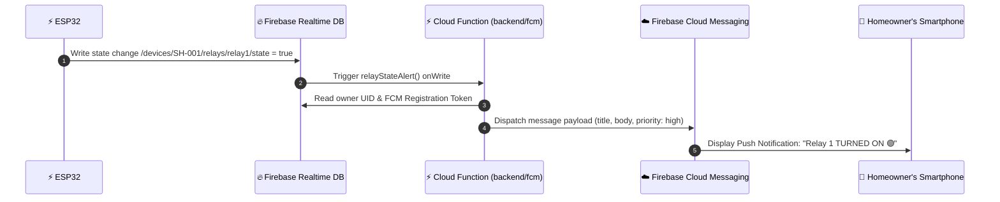

# 📲 Firebase Cloud Messaging (FCM) Push Notifications Setup (Task 11)

This guide documents the architecture, Flutter client integration, and Cloud Function deployment for smartphone push notifications on the ApnaGhar platform.

---

## 1. Notification Event Triggers

1. **Relay State Toggled**: Dispatched whenever an appliance is powered ON or OFF (via manual wall switch, web dashboard, or timer schedule).
2. **Appliance Left ON Warning**: Dispatched if high-draw appliances (e.g. Geyser, AC) stay energized for over 4 continuous hours.
3. **Power Surge Emergency Alert**: Dispatched immediately if the onboard PZEM-004T measures load power exceeding **3,000 Watts**.

---

## 2. Notification Flow Architecture



---

## 3. Flutter Client Configuration

### Step 3.1: Add `firebase_messaging` to `pubspec.yaml`
```yaml
dependencies:
  firebase_core: ^2.27.0
  firebase_messaging: ^14.7.19
```

### Step 3.2: Initialize FCM and Save Token in `lib/main.dart`
```dart
import 'package:firebase_messaging/firebase_messaging.dart';
import 'package:firebase_database/firebase_database.dart';

Future<void> setupFCM(String userUid) async {
  FirebaseMessaging messaging = FirebaseMessaging.instance;

  // Request user permission for notifications
  NotificationSettings settings = await messaging.requestPermission(
    alert: true,
    badge: true,
    sound: true,
  );

  if (settings.authorizationStatus == AuthorizationStatus.authorized) {
    String? token = await messaging.getToken();
    if (token != null) {
      // Store token under user profile in Firebase RTDB
      await FirebaseDatabase.instance
          .ref('users/$userUid/fcmToken')
          .set(token);
    }
  }

  // Handle token refreshes
  messaging.onTokenRefresh.listen((newToken) {
    FirebaseDatabase.instance.ref('users/$userUid/fcmToken').set(newToken);
  });
}
```

---

## 4. Deploying the Cloud Functions

1. Navigate to the FCM backend folder:
   ```bash
   cd backend/fcm
   npm install
   ```
2. Deploy the functions using Firebase CLI:
   ```bash
   firebase deploy --only functions
   ```
3. Verification:
   Test toggling any relay in the dashboard or via manual wall switch and observe real-time delivery on your smartphone.
