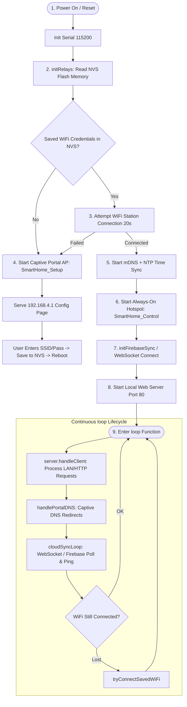
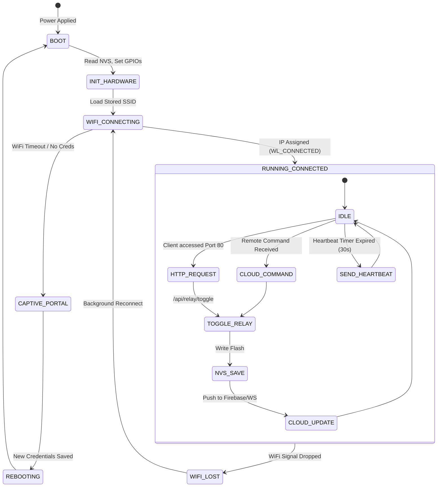

# 💻 Firmware Architecture & Code Structure — ESP32 Home Control

This document breaks down the ESP32 C++ firmware architecture, execution lifecycle, internal state machine, modular file structure, and library dependencies.

---

## 1. Modular Source Code Architecture

The firmware is designed with modular headers to separate concerns between hardware I/O, network management, local web serving, and cloud synchronization:

```
firmware/ (or HomeControlSketch/)
├── HomeControlSketch.ino   # Core orchestrator: setup(), loop(), HTTP routes
├── config.h               # Hardware pin definitions, network credentials, timers
├── relayControl.h         # GPIO driving, state management, NVS flash persistence
├── wifiManager.h          # Captive Portal AP, station mode, mDNS, DNS interceptor
├── firebaseSync.h         # Firebase Realtime Database REST API client & heartbeats
└── serverSync.h           # WebSocket client for self-hosted FastAPI / Railway backend
```

---

## 2. Firmware Lifecycle Flowchart



---

## 3. Firmware State Machine



---

## 4. Detailed Module Descriptions

### A. `config.h` (Hardware & Network Constants)
Contains all user-customizable flags and pin definitions:
- `DEVICE_ID`: Unique alphanumeric string (e.g. `SAKIB7860`).
- `RELAY_PIN_1` to `4`: Mapped to GPIO 23, 22, 21, 19.
- `ACTIVE_LOW = true`: Configures low-level electrical switching logic.
- `ENABLE_ALWAYS_ON_AP = true`: Keeps `SmartHome_Control` active in dual AP+STA mode.

### B. `relayControl.h` (Hardware Abstraction & NVS Memory)
- Uses ESP32's built-in `Preferences.h` (Non-Volatile Storage in Flash).
- Namespace: `"relay-states"`.
- Functions:
  - `initRelays()`: Sets `pinMode(pin, OUTPUT)`, retrieves boolean states (`relay0` through `relay3`) from flash, and writes physical logic voltages immediately.
  - `setRelay(int index, bool state)`: Changes GPIO state, updates RAM array `relayStates[]`, and commits to flash storage (`preferences.putBool`).
  - `toggleRelay(int index)`: Inverts current state.

### C. `wifiManager.h` (Connectivity & Captive Portal)
- Intercepts port 53 DNS requests using `DNSServer` so all network traffic on the setup hotspot redirects automatically to `192.168.4.1`.
- Scans available 2.4GHz WiFi networks and populates dropdown menu in HTML setup wizard.
- Establishes `WiFi.mode(WIFI_AP_STA)` enabling concurrent client connection and station bridge.

### D. `firebaseSync.h` (Firebase Realtime Database REST)
- Provides lightweight REST API integration using ESP32 `HTTPClient`:
  - `firebaseGet(path)`: Fetches JSON node at `https://<FIREBASE_HOST>/<path>.json?auth=<FIREBASE_AUTH>`.
  - `firebasePut(path, data)`: Overwrites path with updated state payload.
  - `firebasePatch(path, data)`: Updates specific fields (e.g., `online: true`, `lastSeen: <timestamp>`).
- Polling Loop: Checks `/devices/<DEVICE_ID>/relays` every 2,000ms and updates local relays upon delta detection.

### E. `serverSync.h` (WebSocket Cloud Adapter)
- High-efficiency alternative to Firebase HTTP polling:
- Connects via secure WebSocket (`wss://`) to Railway backend.
- Listens for asynchronous `relay_cmd` JSON messages from mobile and web apps.
- Dispatches state updates immediately without polling overhead.

---

## 5. Library Dependencies & Tested Versions

| Library Name | Author / Source | Tested Version | Installation Method | Purpose |
|:---|:---|:---:|:---|:---|
| **ESP32 Board Core** | Espressif Systems | `v2.0.14` or `v3.0.x` | Arduino Boards Manager | ESP32 toolchain, FreeRTOS, HAL |
| **WiFi** | Built-in (Espressif) | Built-in | Bundled with ESP32 Core | WiFi 802.11 b/g/n station & AP |
| **WebServer** | Built-in (Espressif) | Built-in | Bundled with ESP32 Core | Embedded HTTP server for port 80 |
| **DNSServer** | Built-in (Espressif) | Built-in | Bundled with ESP32 Core | DNS redirection for captive portal |
| **Preferences** | Built-in (Espressif) | Built-in | Bundled with ESP32 Core | Flash NVS key-value storage |
| **ArduinoJson** | Benoît Blanchon | `^6.21.3` (or `v7.x`) | Arduino Library Manager | Fast embedded JSON parser/serializer |
| **WebSockets** | Markus Sattler | `^2.4.1` | Arduino Library Manager | WebSocket client (`WebSocketsClient.h`)|
| **HTTPClient** | Built-in (Espressif) | Built-in | Bundled with ESP32 Core | Outbound HTTP/HTTPS REST requests |
| **ESPmDNS** | Built-in (Espressif) | Built-in | Bundled with ESP32 Core | Multicast DNS (`smarthome.local`) |

---

## 6. Execution Loop Timing & Non-Blocking Principles

The firmware avoids using long `delay()` calls in the main execution loop:
```cpp
void loop() {
  server.handleClient();         // Non-blocking socket accept/dispatch
  handlePortalDNS();             // Non-blocking DNS packet dispatch
  cloudSyncLoop();               // Uses millis() timer checks
  
  // Non-blocking WiFi reconnect check
  if (!portalActive && wifiConnected && WiFi.status() != WL_CONNECTED) {
    // Reconnect logic
  }
}
```
All recurring routines (`SYNC_INTERVAL`, `HEARTBEAT_INTERVAL`, `TOKEN_RETRY_INTERVAL`) compute elapsed time using:
$$\Delta t = \text{millis}() - t_{\text{previous}}$$
This ensures the local web interface and physical response remain smooth and responsive.
