# 🔌 Hardware List & Wiring Guide — ESP32 Home Control

This guide provides the complete hardware specification, pinout assignments, wiring diagrams, and high-voltage safety instructions for the ESP32 Home Control System.

---

## 1. Components Bill of Materials (BOM)

| Item # | Component | Specification | Quantity | Purpose |
|:---:|:---|:---|:---:|:---|
| 1 | **ESP32 Development Board** | ESP-WROOM-32 / DevKit V1 (30 or 38 pin), Dual-Core 240MHz, 2.4GHz WiFi + BLE | 1 | Main system microcontroller |
| 2 | **4-Channel Relay Module** | 5V DC Coil, 10A 250V AC Contacts, Optocoupler isolation (Songle or equivalent) | 1 | Switching 220V/110V AC electrical appliances |
| 3 | **External DC Power Supply** | 5V 2.0A Regulated DC Adapter (Micro-USB or Barrel Jack) | 1 | Powering ESP32 and relay module coils reliably |
| 4 | **Jumper Wires** | Female-to-Female & Male-to-Female Dupont wires (20cm) | ~15 | Logic connections between ESP32 and relay board |
| 5 | **Breadboard / Perfboard** | Half-size solderless breadboard (prototype) or PCB | 1 | Prototyping signal wiring |
| 6 | **Environment Sensor (Optional)** | DHT11 or DHT22 Temperature & Humidity Sensor | 1 | Room temperature & humidity telemetry |
| 7 | **Terminal Blocks & AC Wires** | 1.5mm² (16 AWG) stranded copper wire, rated 10A | As needed | High-voltage mains load wiring |
| 8 | **Electrical Enclosure** | Flame-retardant ABS project box (min 150x100x50mm) | 1 | Isolating high-voltage AC from human contact |

---

## 2. ESP32 Pin Mapping Table

The ESP32 has 48 internal GPIO lines, but not all exposed pins on DevKit boards are safe to use for driving inductive relays. The table below details the active pin selection:

| ESP32 Pin | Connected To | Role in System | Why This Pin? | Safe For Relays? | Notes / Strapping Alert |
|:---:|:---:|:---:|:---|:---:|:---|
| **GPIO 23** | Relay Channel 1 IN | Switch 1 (Living Room) | General GPIO, default LOW on boot | ✅ **100% Safe** | No strapping conflicts |
| **GPIO 22** | Relay Channel 2 IN | Switch 2 (Bedroom) | General GPIO | ✅ **100% Safe** | Default hardware I2C SCL |
| **GPIO 21** | Relay Channel 3 IN | Switch 3 (Kitchen) | General GPIO | ✅ **100% Safe** | Default hardware I2C SDA |
| **GPIO 19** | Relay Channel 4 IN | Switch 4 (Fan) | General GPIO | ✅ **100% Safe** | VSPI MISO, safe output |
| **VIN / 5V** | 5V Power Supply | 5V DC Power Input | Powers internal 3.3V LDO | ✅ **Safe** | Use regulated 5V source |
| **GND** | Relay GND & Power GND | Common Ground Reference | Signal return path | ✅ **Crucial** | **Must connect all grounds together** |
| *GPIO 4 (Opt)* | DHT11/DHT22 Data | Temperature/Humidity | Standard 1-Wire bus | ✅ **Safe** | Requires 10k pull-up resistor |

### ⚠️ Pins That MUST Be Avoided for Relays

| Pin Range / Pin | Name | Reason to Avoid |
|:---|:---|:---|
| **GPIO 6 to 11** | SPI Flash Pins | Connected directly to the integrated SPI flash chip. Connecting to relays causes immediate ESP32 crash. |
| **GPIO 34, 35, 36, 39** | Input-Only (GPI) | Do not have internal output drivers or pull-up transistors. Cannot drive a relay coil. |
| **GPIO 0, 2, 12, 15** | Strapping Pins | Determine boot mode (UART download vs SPI flash boot). Connecting low-impedance relay inputs can pull pins LOW during boot, preventing ESP32 from booting up. |

---

## 3. System Wiring Diagram

### Mermaid Schematic: Complete Signal & Power Distribution

```mermaid
graph TD
    subgraph POWER_SUPPLY [5V 2A Regulated DC Adapter]
        PS_VCC["+5V Output (DC)"]
        PS_GND["GND Output (DC)"]
    end

    subgraph ESP32_BOARD [ESP32 DevKit V1]
        ESP_VIN["VIN / 5V Pin"]
        ESP_GND["GND Pin"]
        G23["GPIO 23"]
        G22["GPIO 22"]
        G21["GPIO 21"]
        G19["GPIO 19"]
    end

    subgraph RELAY_BOARD [4-Channel 5V Relay Board]
        R_VCC["VCC (Logic)"]
        R_JD["JD-VCC (Coil Power)"]
        R_GND["GND Pin"]
        IN1["IN 1"]
        IN2["IN 2"]
        IN3["IN 3"]
        IN4["IN 4"]
    end

    subgraph AC_LOADS [AC Mains Power: 220V / 110V]
        AC_LIVE["AC Live (Phase)"]
        AC_NEUTRAL["AC Neutral"]
        BULB1["Living Room Light"]
        BULB2["Bedroom Light"]
        BULB3["Kitchen Light"]
        FAN["Ceiling Fan"]
    end

    %% DC Power Routing
    PS_VCC ==>|5V DC| ESP_VIN
    PS_VCC ==>|5V DC| R_JD
    PS_VCC -.->|Logic 5V| R_VCC
    PS_GND ==>|Common GND| ESP_GND
    PS_GND ==>|Common GND| R_GND

    %% Logic Signals
    G23 -->|Signal| IN1
    G22 -->|Signal| IN2
    G21 -->|Signal| IN3
    G19 -->|Signal| IN4

    %% AC High Voltage Routing
    AC_LIVE ==>|Mains Line| R1_COM["Relay 1 COM"]
    AC_LIVE ==>|Mains Line| R2_COM["Relay 2 COM"]
    AC_LIVE ==>|Mains Line| R3_COM["Relay 3 COM"]
    AC_LIVE ==>|Mains Line| R4_COM["Relay 4 COM"]

    R1_NO["Relay 1 NO"] --> BULB1 --> AC_NEUTRAL
    R2_NO["Relay 2 NO"] --> BULB2 --> AC_NEUTRAL
    R3_NO["Relay 3 NO"] --> BULB3 --> AC_NEUTRAL
    R4_NO["Relay 4 NO"] --> FAN --> AC_NEUTRAL
```



---

## 4. Optical Isolation & The JD-VCC Jumper

Most 4-channel relay modules come with a small plastic jumper cap bridging **`VCC`** and **`JD-VCC`**:

```
[ VCC ] [ JD-VCC ] [ GND ]   <-- Jumper on these pins by default
```

> [!CRITICAL]
> **Understanding JD-VCC for Electrical Isolation:**
> - When the jumper is ON: The ESP32 5V line directly powers both the optocoupler LEDs and the mechanical magnetic coils. If a coil switches, electromagnetic inductive kickback can travel back into the ESP32, triggering a system crash or brownout.
> - **Optimum Isolation Method (Recommended)**:
>   1. Remove the plastic jumper between `VCC` and `JD-VCC`.
>   2. Connect `JD-VCC` directly to external 5V adapter positive (`+5V`).
>   3. Connect `GND` of relay board to external 5V adapter negative (`GND`).
>   4. Connect `VCC` on the relay board to the ESP32 `3.3V` or `5V` pin (to power the internal optocoupler diode).
>   5. Connect `IN1-IN4` to ESP32 GPIOs.
>   This guarantees complete optical isolation between the relay coils and the ESP32 CPU!

---

## 5. Active-LOW vs. Active-HIGH Logic

Standard 4-channel relay boards use PNP transistors driving optocouplers:
- **Active-LOW (Default)**:
  - ESP32 Pin `LOW` (0V) $\rightarrow$ Current flows through optocoupler LED $\rightarrow$ Relay clicks **ON**.
  - ESP32 Pin `HIGH` (3.3V) $\rightarrow$ Optocoupler LED turns off $\rightarrow$ Relay clicks **OFF**.
- In `firmware/config.h`:
  ```cpp
  const bool ACTIVE_LOW = true;
  #define RELAY_ON  (ACTIVE_LOW ? LOW : HIGH)
  #define RELAY_OFF (ACTIVE_LOW ? HIGH : LOW)
  ```

---

## 6. High-Voltage Mains Safety Protocol

> [!CAUTION]
> **DANGER: MAINS VOLTAGE (110V - 240V AC) CAN BE FATAL**
> 1. **Never work on live circuits**: Turn off the main circuit breaker / MCB before touching any AC wiring.
> 2. **Physical Separation**: Keep low-voltage DC wires (ESP32, sensors) physically separated by at least 15mm from high-voltage AC wires.
> 3. **Proper Wire Sizing**: Use minimum 1.0mm² to 1.5mm² insulated copper wire for domestic lighting and 2.5mm² for heavy loads.
> 4. **COM and NO Terminals**: Always wire the Live (Phase) wire through the **COM (Common)** and **NO (Normally Open)** terminals. In case of microcontroller power failure, the circuit remains OPEN and safe.

---

## 7. Physical Wiring Photo Placeholder

```
+-------------------------------------------------------------+
|                                                             |
|           [ PLACEHOLDER: ACTUAL HARDWARE WIRING PHOTO ]     |
|                                                             |
|   Insert photograph here showing:                           |
|   - ESP32 DevKit mounted on prototype board                 |
|   - 4-Channel Relay Module with DuPont jumpers              |
|   - 5V 2A Power Supply with shared common ground            |
|   - AC Terminal connections with safety insulation covers   |
|                                                             |
+-------------------------------------------------------------+
```
