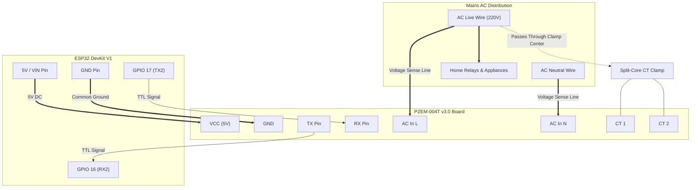

# ⚡ Hardware Current & Energy Sensing Guide (PZEM-004T & ACS712)

This document provides detailed electrical schematics, pin connections, wiring rules, and calibration math for hardware-level electrical monitoring on the ESP32 Home Control platform.

---

## 1. Sensor Options Overview

| Feature | **PZEM-004T v3.0 (Primary / Recommended)** | **ACS712-20A (Fallback)** |
|:---|:---|:---|
| **Parameters Measured** | Voltage (V), Current (A), Active Power (W), Energy (kWh), Frequency (Hz), Power Factor (PF) | Current (A) only |
| **Interface** | UART Serial2 (TTL 5V/3.3V) | Single Analog ADC Pin |
| **Accuracy** | $\pm 0.5\%$ (Laboratory & Billing Grade) | $\pm 2.5\%$ to $5.0\%$ (Temperature sensitive) |
| **Isolation** | Optical isolation + Non-invasive split-core CT | 2.1kV RMS galvanic Hall-effect |
| **Maximum Current** | Up to 100A with included CT clamp | 20A peak |

---

## 2. PZEM-004T v3.0 Wiring Schematic



---

## 3. Critical Wiring Rules for Current Transformers (CT)

> [!CAUTION]
> **RULE #1: CLAMP ONLY ONE CONDUCTOR**
> Never clamp the CT around a 2-wire cord (Live + Neutral together). The magnetic flux generated by current flowing out on Live is exactly canceled by current returning on Neutral, resulting in an exact 0.00A reading.
> - **Correct**: Open the outer jacket and clamp strictly around the single **LIVE (Phase)** wire.

> [!WARNING]
> **RULE #2: NEVER OPEN-CIRCUIT A LIVE CT**
> A current transformer operating around an energized load without a burden resistor or terminal connection can induce thousands of volts across its secondary leads. Ensure the blue 2-pin screw terminal from the CT is securely fastened into the PZEM board before energizing the mains.

---

## 4. Pin Connections

| PZEM-004T Pin | Connected to ESP32 Pin | Logic Level | Description |
|:---:|:---:|:---:|:---|
| **VCC** | **VIN / 5V** | 5.0V DC | Module power supply |
| **GND** | **GND** | 0.0V DC | Common ground |
| **TX** | **GPIO 16 (RX2)** | 3.3V / 5V | Serial data from PZEM to ESP32 |
| **RX** | **GPIO 17 (TX2)** | 3.3V / 5V | Command queries from ESP32 to PZEM |
| **L (AC)** | **Mains Live** | 110V - 240V AC | Voltage reference |
| **N (AC)** | **Mains Neutral** | 0V AC Reference | Voltage reference |

---

## 5. Software Integration

The firmware reads the sensor every 10 seconds via `firmware/powerSensor.h`:
```cpp
PowerData d = readPowerData();
if (d.valid) {
    Firebase.RTDB.setFloatAsync(&fbdo, "/devices/SH-001/power/voltage", d.voltage);
    Firebase.RTDB.setFloatAsync(&fbdo, "/devices/SH-001/power/current", d.current);
    Firebase.RTDB.setFloatAsync(&fbdo, "/devices/SH-001/power/power", d.power);
    Firebase.RTDB.setFloatAsync(&fbdo, "/devices/SH-001/power/energy", d.energy);
}
```
This enables the web dashboard and mobile app to display live line voltage fluctuations, instantaneous wattage draw, and real kilowatt-hour consumption.
