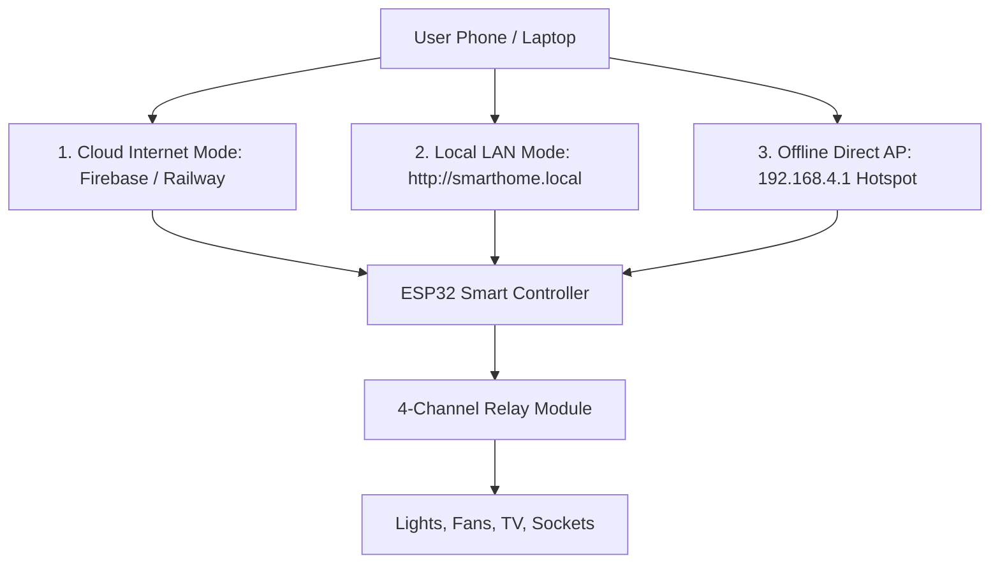

# 📋 Product Requirement Document (PRD) — ESP32 Home Control

**Project Name**: ApnaGhar (ESP32 Home Control Using Firebase & Cloud)  
**Lead Architect**: Mohammad Sakib Ahmad (`@MohammadSakibAhmad0874`)  
**Target Platform**: ESP32 Microcontroller, Web (Vercel), Mobile (Flutter), Cloud Backend (Firebase / Railway)  
**Status**: Active / In Review

---

## 1. Executive Summary & Vision

### What is ESP32 Home Control?
ESP32 Home Control is an IoT smart home automation platform that converts standard residential electrical switches (lights, ceiling fans, plugs, appliances) into smart, connected switches. It allows users to monitor and switch appliances on or off from:
1. **Anywhere in the world** via internet-connected Cloud / Firebase Realtime Database.
2. **Local home network** using WiFi and local web server (`http://smarthome.local`).
3. **Direct offline connection** via ESP32's built-in always-on WiFi hotspot, even when internet or home router is completely down.

### Why Did We Build It?
Traditional commercial smart switches (Tuya, Sonoff, Smart Life) come with major downsides:
- **Vendor lock-in & privacy risks**: User data travels through overseas closed-source cloud servers.
- **Internet dependency**: Many commercial switches become non-responsive if home broadband drops.
- **High cost**: Retrofitting an entire home with commercial switches is expensive.
- **Lack of flexibility**: Closed APIs make it difficult to integrate custom automation, power usage tracking, or local offline fallbacks.

**ApnaGhar provides open, flexible, multi-path home automation**:

---

## 2. Target Users & User Personas

| Persona | Description | Primary Needs |
|:---|:---|:---|
| **Homeowner (Primary)** | Everyday user wanting to control lights/fans effortlessly from phone. | Simple UI, no technical jargon, works even when WiFi drops, safe operation. |
| **Elderly / Family Member** | Non-tech-savvy users in the household. | Instant physical or one-tap phone control, clear ON/OFF status indicators. |
| **IoT Maker / Developer** | Technical user expanding or auditing the system. | Open-source firmware, secure API keys, REST/WebSocket interfaces, customizable pinouts. |

---

## 3. Key Functional Features

### 1. 4-Channel Appliance Control
- Individually switch up to 4 high-voltage AC electrical loads (lights, ceiling fans, table lamps, exhaust fans).
- Active-LOW relay coil driving for compatibility with 99% of commercial relay modules.
- Power-cut state persistence: Saves each switch state in Non-Volatile Flash Storage (NVS) using `Preferences.h`. If electricity cuts and returns, appliances restore to their previous states.

### 2. Multi-Mode Connectivity
- **Captive Portal Setup Wizard**: When first powered on, broadcasts `SmartHome_Setup`. Connecting a phone opens a setup page to select home WiFi SSID and password without writing a line of code.
- **Always-On Hotspot (AP+STA Dual Mode)**: Broadcasts `SmartHome_Control` (`192.168.4.1`) even while simultaneously connected to home WiFi.
- **mDNS Zero-Config Discovery**: Type `http://smarthome.local` into any browser on the local network.

### 3. Real-Time Cloud Synchronization
- **Firebase Realtime Database integration**: Millisecond-level state sync across web dashboards, mobile apps, and microcontrollers.
- **Two-way sync**: Changing a switch locally updates cloud state; toggling in the cloud triggers physical relay immediately.
- **Heartbeat & Online Telemetry**: Broadcasts device `online` status and `lastSeen` timestamp every 30 seconds.

### 4. Smart Scheduling & Automation
- Automated time-of-day ON/OFF scheduling with day-of-week selection (e.g., "Turn on Garden Light at 18:30 Mon-Fri").
- Server-side background schedule executor with duplicate-execution prevention.

### 5. Energy & Usage Tracking
- Track operating hours per relay.
- Calculate estimated energy consumption (kWh) and billing cost in Indian Rupees (₹) based on load wattage.

### 6. Security & Device Claiming
- Unique `DEVICE_ID` architecture: Users register on the dashboard and claim their physical hardware using their device code.
- Admin panel to monitor all deployed devices across users.

---

## 4. User Stories

1. **Remote Control Story**:
   > *"As a homeowner on vacation, I want to check my phone to see if my living room lights were left on and turn them off remotely with one tap, so I can save electricity and keep my home secure."*

2. **Offline Fallback Story**:
   > *"As a family member during an internet broadband outage, I want to connect my phone to the switch's direct WiFi hotspot and control the bedroom fan without requiring internet."*

3. **No-Code Setup Story**:
   > *"As a new user without Arduino programming skills, I want to configure the device to connect to my home WiFi through my smartphone browser without having to edit C++ code."*

4. **Power Failure Resilience Story**:
   > *"As a homeowner in an area with frequent power cuts, I want the smart switch to remember that my refrigerator and hallway lamp were ON when power went out, so they turn back ON automatically when power restores."*

---

## 5. MVP vs. Future Scope

```mermaid
graph LR
    subgraph MVP [Phase 1 & 2: Core MVP]
        R1[4-Channel Relay Control]
        R2[Captive Portal WiFi Setup]
        R3[NVS State Memory]
        R4[Firebase / WebSocket Sync]
        R5[Web Dashboard & Admin Panel]
    end

    subgraph FUTURE [Phase 3 & 4: Production & Future]
        F1[Custom Compact PCB]
        F2[Hardware Current Sensor PZEM-004T]
        F3[Alexa & Google Assistant Voice Skills]
        F4[Over-the-Air OTA Updates]
        F5[Mobile Push Notifications FCM]
        F6[Physical Manual Switch Detection]
    end

    MVP --> FUTURE
```

| Dimension | MVP (Current Implementation) | Future Release (Production v2.0+) |
|:---|:---|:---|
| **Hardware** | ESP32 DevKit + 4-Relay Module + Jumper Wires | Custom 2-Layer PCB + Optocoupler + MOV Surge Protection |
| **Enclosure** | Loose components / Prototype breadboard | Fire-retardant 3D-printed enclosure with DIN-rail mount |
| **Firmware Update** | USB Cable flash via Arduino IDE | Over-The-Air (OTA) web firmware upload |
| **Power Measurement** | Software math estimation ($P = V \times I \times t$) | Real hardware current transformer (CT / PZEM-004T) |
| **Voice Control** | Manual web/app button | Native Alexa Smart Home Skill & Google Action |
| **Physical Wall Switch**| Virtual app control only | Bi-directional integration with standard physical wall switches |
| **Mobile App** | Web app + Flutter codebase in progress | Production signed APK / iOS App Store release with Push Notifications |
