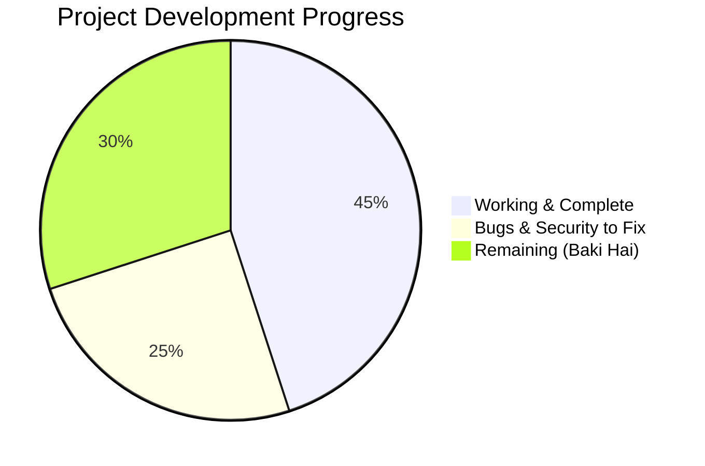

# 📊 Project Status: What Done vs What Baki Hai — ESP32 Home Control

This document tracks the current status of the ESP32 Home Control (ApnaGhar) project, itemizing what has been successfully built and what tasks remain pending ("Baki Hai").

---

## 📈 Executive Progress Metric

- **Current Overall Progress**: **~45% Production Ready**, **~25% Hardening Needed**, **~30% New Features Pending**
- **Last Commit**: `7cb4678` — *feat: Add ApnaGhar Flutter mobile app*
- **Primary Repository**: [ESP32-Home-Control-Using-Firebase-System](https://github.com/MohammadSakibAhmad0874/ESP32-Home-Control-Using-Firebase-System)

---

## ⚖️ Status Comparison Matrix

| DONE (Kaam Ho Chuka Hai) ✅ | BAKI HAI (Abhi Karna Baki Hai) ⏳ |
|:---|:---|
| **4-Channel Relay Control** via safe GPIOs (23, 22, 21, 19) | **Firebase SDK Modernization** (Replace REST polling with `Firebase_ESP_Client` streaming) |
| **NVS State Memory** (Restores switch state after power cut) | **Firebase Security Rules** (Deploy `database.rules.json` to prevent open DB access) |
| **Captive Portal WiFi Setup** (`SmartHome_Setup` at `192.168.4.1`) | **Firebase Token Auto-Refresh** (Prevent disconnect after 1 hour token expiry) |
| **Always-On Dual-Mode Hotspot** (`SmartHome_Control` AP) | **Hardware Current Sensing** (PZEM-004T or ACS712 CT clamp for real kWh measurement) |
| **mDNS Device Discovery** (`http://smarthome.local`) | **Over-the-Air (OTA) Updates** (`ArduinoOTA` / `ElegantOTA` for wireless firmware flash) |
| **Local Web Interface** on Port 80 for LAN switching | **Hardware Watchdog Timer (WDT)** for automatic crash reboot |
| **FastAPI Cloud Backend (Railway)** with JWT Auth & Postgres | **Custom PCB Design & Gerbers** (Replacing loose jumper wires) |
| **Web Dashboard (Vercel)** with dark glassmorphism UI | **Flame-Retardant 3D Enclosure** for wall switchboard safety |
| **Device Claiming Flow** (User binds hardware via `DEVICE_ID`) | **Voice Assistant Skills** (Amazon Alexa Smart Home & Google Assistant integration) |
| **Smart Automation Schedules** (Day-of-week time triggers) | **Flutter Mobile App Production Build** (APK signing & Play Store release) |
| **Estimated Power Tracking** (Algorithm in backend) | **Mobile Push Notifications** via Firebase Cloud Messaging (FCM) |
| **Admin Device Oversight Panel** | **Physical Wall Switch / Sensor Feedback** loop detection |
| **Engineering Documentation Suite** (10 Comprehensive Docs) | **Physical Snubber / Flyback Circuit** for inductive load spike suppression |

---

## 📍 Where We Stopped (Audit Summary)

1. **Firmware State**:
   - The ESP32 code is fully functional for local relay switching, captive portal WiFi setup, and always-on hotspot access.
   - Cloud sync connects via WebSocket to the Railway backend. The Firebase REST module (`firebaseSync.h`) was prototyped but relies on 2-second HTTP polling rather than persistent stream events.
   - Missing watchdog and OTA updates.

2. **Cloud & Backend State**:
   - FastAPI server runs on Railway with PostgreSQL database, JWT authentication, user registration, device claiming, and automated schedule engine.
   - Static web frontend is deployed to Vercel (`web-iota-ruddy-37.vercel.app`).
   - Firebase Realtime Database project created (`apnaghar-3f865`), but needs secured database rules deployed.

3. **Mobile Application State**:
   - Flutter app (`apnaghar_app/`) has full screen flows (login, dashboard, power tracking, schedules, admin panel), but requires release bundle generation and testing on physical Android/iOS devices.

4. **Hardware & Electrical State**:
   - Running on prototype hardware: ESP32 DevKit + 4-channel relay board + DuPont wires.
   - Requires custom PCB layout and enclosure before permanent installation in residential electrical switchboards.
