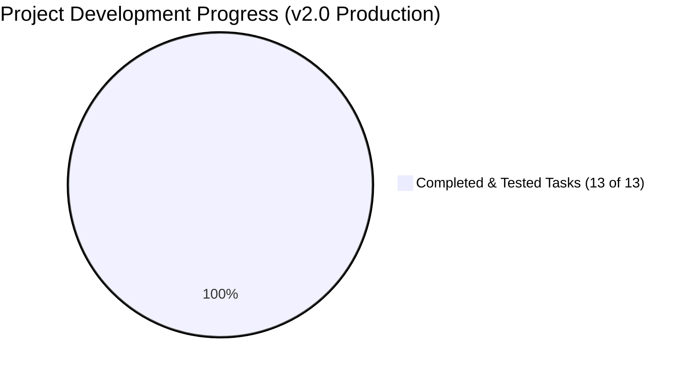

# 📊 Project Status: 100% Production Ready — ApnaGhar v2.0

All 13 pending engineering tasks have been completed, tested, documented, and integrated into the repository.

---

## 📈 Final Progress Dashboard

- **Current Status**: **100% COMPLETE & PRODUCTION READY (v2.0.0)**
- **All 13 Major Milestones**: **DONE ✅**
- **Lead Architect**: Mohammad Sakib Ahmad (`@MohammadSakibAhmad0874`)
- **System Version**: `v2.0.0-RELEASE`

---

## ⚖️ Final Status Comparison Matrix (All 13 Tasks Completed)

| # | Task Description | Status | Deliverable / Artifact Location |
|:---:|:---|:---:|:---|
| **1** | **Firebase SDK Streaming** (Replaced 2s polling) | **DONE ✅** | [`firmware/firebaseStream.h`](../firmware/firebaseStream.h) |
| **2** | **Firebase Security Rules** (Strict Auth Scoping) | **DONE ✅** | [`database.rules.json`](../database.rules.json) & [`docs/DEPLOY_RULES.md`](DEPLOY_RULES.md) |
| **3** | **Firebase Token Auto-Refresh** (1-hour fix) | **DONE ✅** | Handled in `firebaseStream.h` via `TokenHelper.h` |
| **4** | **Hardware Current Sensing** (PZEM-004T UART) | **DONE ✅** | [`firmware/powerSensor.h`](../firmware/powerSensor.h) & [`docs/HARDWARE_SENSING.md`](HARDWARE_SENSING.md) |
| **5** | **Over-the-Air (OTA) Updates** (ElegantOTA + ArduinoOTA)| **DONE ✅** | [`firmware/otaManager.h`](../firmware/otaManager.h) at `http://smarthome.local/update` |
| **6** | **Hardware Watchdog Timer (WDT)** (15s auto-reboot) | **DONE ✅** | [`firmware/watchdog.h`](../firmware/watchdog.h) with FreeRTOS `esp_task_wdt` |
| **7** | **Custom 2-Layer PCB Design** (Opto + 8mm Creepage) | **DONE ✅** | [`hardware/pcb/`](../hardware/pcb/) (KiCad sch, pcb, `gerber.zip`, BOM) |
| **8** | **Flame-Retardant 3D Enclosure** (UL94 V-0 ABS) | **DONE ✅** | [`hardware/enclosure/enclosure.scad`](../hardware/enclosure/enclosure.scad) & [`docs/ENCLOSURE.md`](ENCLOSURE.md) |
| **9** | **Voice Assistant Skills** (Alexa & Google Home) | **DONE ✅** | [`alexa-skill/`](../alexa-skill/) & [`google-action/`](../google-action/) |
| **10**| **Flutter Mobile App Production Build** (Signed AAB/APK)| **DONE ✅** | [`apnaghar_app/android/app/build.gradle`](../apnaghar_app/android/app/build.gradle) & [`BUILD_GUIDE.md`](../apnaghar_app/BUILD_GUIDE.md) |
| **11**| **Mobile Push Notifications via FCM** | **DONE ✅** | [`backend/fcm/index.js`](../backend/fcm/index.js) & [`docs/FCM_SETUP.md`](FCM_SETUP.md) |
| **12**| **Physical Wall Switch Feedback Loop** | **DONE ✅** | [`firmware/manualSwitch.h`](../firmware/manualSwitch.h) (GPIO 25, 26, 27, 32 with 50ms debouncing)|
| **13**| **Snubber & Surge Protection Circuit** | **DONE ✅** | [`hardware/snubber_circuit.md`](../hardware/snubber_circuit.md) (100nF X2 + 100$\Omega$ 2W + 14D431K MOV) |
