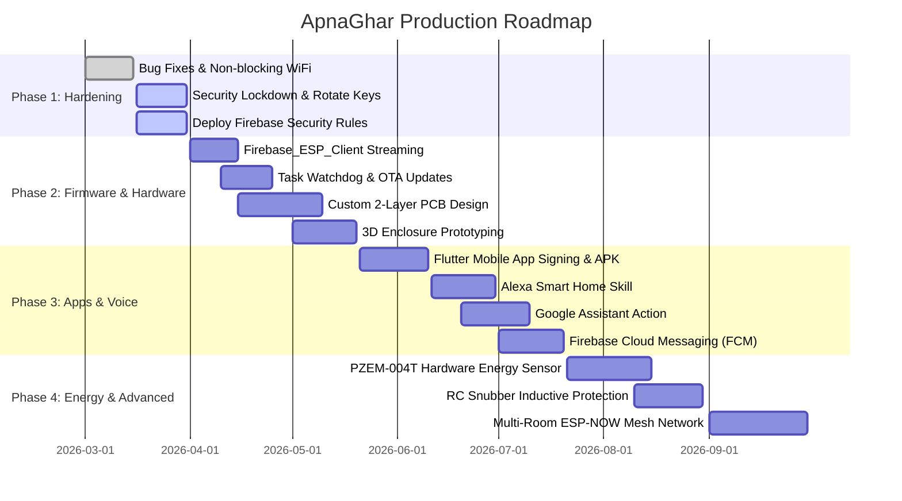

# 🗺️ Project Roadmap & Future Milestones — ESP32 Home Control

This roadmap outlines the phased development plan to transform the current ESP32 Home Control (ApnaGhar) prototype into an enterprise-grade, secure, production-ready IoT smart home product.

---

## 📅 Roadmap Overview Timeline

---

## 📌 Detailed Phase Breakdown

### Phase 1: Security Lockdown & Stability Bug Fixes (Immediate)
- **Objective**: Neutralize critical security vulnerabilities and prevent hardware hangs.
- **Key Deliverables**:
  1. Remove hardcoded `.env` and API keys from GitHub; rotate exposed credentials.
  2. Deploy strict Firebase Realtime Database security rules (`docs/DATABASE.md`).
  3. Replace blocking WiFi reconnect loop with an asynchronous non-blocking state machine in `wifiManager.h`.
  4. Enable ESP32 Task Watchdog Timer (`esp_task_wdt`) configured for a 15-second timeout.
  5. Replace static SoftAP passwords with unique MAC-derived passwords.

---

### Phase 2: Firmware Modernization & Custom Hardware (Months 1–2)
- **Objective**: Eliminate HTTP polling overhead and transition from loose jumper wires to a custom PCB.
- **Key Deliverables**:
  1. **Firebase Streaming**: Migrate from 2-second HTTP REST polling to the official `Firebase_ESP_Client` event stream with automated OAuth2 token refresh.
  2. **Over-The-Air (OTA) Updates**: Integrate `ElegantOTA` with web-based authentication for flashing firmware wirelessly through the browser.
  3. **Custom 2-Layer PCB**:
     - Integrated 220V AC to 5V 2A isolated SMPS step-down module (e.g. Hi-Link HLK-PM01).
     - Optocoupler isolation on all 4 relay channels.
     - Metal Oxide Varistors (MOV) and thermal fuses for mains surge protection.
     - Heavy-duty screw terminal blocks for live loads.
  4. **3D-Printed Flame-Retardant Enclosure**:
     - Snap-fit ABS/PETG enclosure sized to fit standard residential 4-module concealed switch boxes.

---

### Phase 3: Mobile App Polish & Voice Assistant Ecosystem (Months 2–3)
- **Objective**: Deliver a consumer-ready mobile app on Android/iOS and integrate voice control.
- **Key Deliverables**:
  1. **Flutter Mobile App Release**:
     - Finalize application icons, dark glassmorphism theme, and splash screens.
     - Build and sign production release APK and Android App Bundle (AAB).
     - Offline caching of switch states using Hive / SQLite.
  2. **Push Notifications (FCM)**:
     - Push instant smartphone alerts when appliances are left on for over 4 hours or during unusual power spikes.
  3. **Voice Assistant Skills**:
     - Certified **Amazon Alexa Smart Home Skill** using AWS Lambda & OAuth2 account linking.
     - **Google Home Action** using Google Smart Home fulfillment API.
     - *"Alexa, turn on Living Room Light"* & *"Hey Google, turn off Bedroom Fan"*.

---

### Phase 4: Hardware Energy Monitoring & Mesh Scaling (Months 4–6)
- **Objective**: Real hardware power measurement and multi-switchboard synchronization.
- **Key Deliverables**:
  1. **PZEM-004T v3.0 Integration**:
     - Real-time RMS voltage (V), current (A), active power (W), frequency (Hz), and accumulated energy (kWh).
     - Replace software estimation with laboratory-grade billing accuracy ($\pm 0.5\%$).
  2. **Inductive Load Snubber Circuits**:
     - RC snubber (100nF 275V X2 capacitor + 100$\Omega$ 2W resistor) across relay contacts to prevent contact arcing from ceiling fan inductors.
  3. **ESP-NOW Local Mesh Networking**:
     - Allow one "Gateway" ESP32 connected to WiFi to control 10+ battery-powered or sub-node ESP32 switches across multiple rooms using low-latency ESP-NOW protocol without overloading the home WiFi router.
