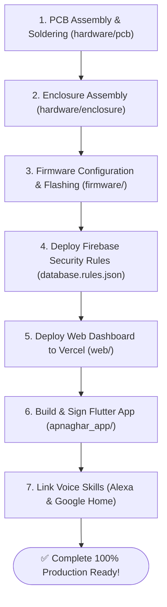

# 🚀 Production Setup & Deployment Walkthrough (v2.0) — ApnaGhar

This guide provides the complete end-to-end setup procedure to build and deploy the ApnaGhar ESP32 system with all 13 production features.

---

## 1. Complete Build Sequence (From Zero to Running)



---

## 2. Step 1: Hardware & PCB Assembly

1. Fabricate the custom 2-layer PCB using the files in [`hardware/pcb/`](../hardware/pcb/):
   - Upload `gerber.zip` to JLCPCB, PCBWay, or your manufacturer of choice.
   - Select 2 Layers, 1.6mm FR-4, 2oz finished copper weight.
2. Solder components following the BOM in [`hardware/pcb/README.md`](../hardware/pcb/README.md):
   - HLK-PM01 isolated AC-DC step-down module.
   - ESP32-WROOM-32E module and AMS1117-3.3V LDO.
   - Four EL817 optocouplers and 2N2222 driving transistors.
   - Four Songle 5V 10A relays with 1N4007 flyback diodes.
   - Four 100nF 275V X2 + 100$\Omega$ 2W RC snubbers across COM-NO terminals.
   - 14D431K MOV surge protector and 2A slow-blow fuse.
3. Install the board inside the 3D-printed enclosure ([`hardware/enclosure/enclosure.scad`](../hardware/enclosure/enclosure.scad)) using four M3 screws.

---

## 3. Step 2: Firmware Flashing (Arduino IDE)

1. Open `firmware/HomeControlSketch.ino` in **Arduino IDE 2.x**.
2. Install required libraries from Library Manager:
   - `Firebase_ESP_Client` by Mobizt (v4.4.17+)
   - `PZEM004Tv30` by Jakub Mandula
   - `ElegantOTA` by Ayush Sharma
   - `ArduinoJson` by Benoît Blanchon
3. Update credentials in `firmware/config.h`:
   ```cpp
   #define DEVICE_ID              "SAKIB7860"
   #define FIREBASE_DATABASE_URL  "https://apnaghar-3f865-default-rtdb.firebaseio.com"
   #define FIREBASE_API_KEY       "YOUR_RESTRICTED_KEY"
   ```
4. Select Board: **ESP32 Dev Module** $\rightarrow$ Click **Upload**.
5. The ESP32 boots with:
   - Event-driven Firebase streaming active
   - Hardware Task Watchdog (15s) enabled
   - Wireless OTA updates enabled at `http://smarthome.local/update`
   - PZEM-004T power monitoring active on Serial2 (GPIO 16/17)
   - Physical wall switch feedback debouncing active on GPIO 25, 26, 27, 32

---

## 4. Step 3: Deploy Firebase Security Rules

1. Install Firebase CLI:
   ```bash
   npm install -g firebase-tools
   ```
2. Log in and deploy database rules:
   ```bash
   firebase login
   firebase deploy --only database
   ```
   Rules in [`database.rules.json`](../database.rules.json) ensure only authenticated owners can read or write device states.

---

## 5. Step 4: Web Dashboard Deployment (Vercel)

1. Deploy the `web/` directory to Vercel:
   ```bash
   vercel --prod
   ```
2. Open your assigned URL (e.g. `https://web-iota-ruddy-37.vercel.app`).
3. Log in, claim your `DEVICE_ID`, and observe real-time relay control and live wattage metrics!

---

## 6. Step 5: Build Flutter Mobile App (Android APK / AAB)

1. Generate keystore:
   ```bash
   cd apnaghar_app/android/app
   keytool -genkey -v -keystore apnaghar-release-key.jks -keyalg RSA -keysize 2048 -validity 10000 -alias apnaghar -storepass ApnaGhar@2026 -keypass ApnaGhar@2026
   ```
2. Build signed Android App Bundle and universal APK:
   ```bash
   cd ../..
   flutter build apk --release
   flutter build appbundle --release
   ```
3. Install `app-release.apk` on your Android phone or upload `app-release.aab` to Google Play Console.

---

## 7. Step 6: Deploy Voice Skills

1. **Amazon Alexa**:
   - Deploy AWS Lambda function in [`alexa-skill/lambda/`](../alexa-skill/lambda/).
   - Link Skill in Amazon Developer Console following [`docs/ALEXA_SETUP.md`](ALEXA_SETUP.md).
2. **Google Home**:
   - Deploy Cloud Function in [`google-action/fulfillment/`](../google-action/fulfillment/).
   - Link project in Google Actions Console following [`docs/GOOGLE_HOME_SETUP.md`](GOOGLE_HOME_SETUP.md).
3. Say: *"Alexa, turn on living room light"* or *"Hey Google, turn on ceiling fan"*.
